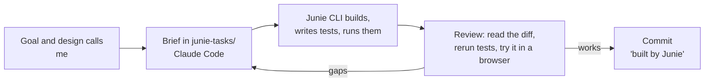

# AI showcase: how Cloudburst was built

Cloudburst was built by one person working with two AI coding agents. I set the goals,
made the design calls and approved every change. **Claude Code** (Anthropic) was my lead
engineer: it built the game core, wrote the task briefs and reviewed every change.
**Junie** (JetBrains' coding agent, run from the Junie CLI) was a second engineer that
took whole features from a brief to tested code. **WebStorm** holds the project, its
shared run setups and the test runner.

Everything below can be checked in this repo: the briefs Junie got are in
[`junie-tasks/`](junie-tasks/), Junie's own run logs sit next to them, and each Junie
feature is a separate commit marked "built by Junie".

## The workflow

1. **Core first, with a test harness.** The game core (three rounds, scoring, renderer,
   state machine) came first, together with scripted bot players at four skill levels.
   The bots play the real game in Node with no browser, so every later change has a
   safety net. They also set the score tiers: `tests/calibrate.mjs` plays 160 bot
   games, and the tiers sit where casual, regular, good and pro players land.
2. **Features as briefs.** Each new feature became a Markdown brief: what to build, the
   constraints (no network, no new dependencies, don't touch the scoring), and a
   "Done means" line naming the tests that must pass. The brief goes into the repo,
   so it doubles as the design record.
3. **Junie builds it.** `junie-tasks/run.ps1` starts the Junie CLI on a brief and saves
   the console output. Junie reads the code, writes the feature and its tests, runs the
   whole suite, and reports.
4. **Review like a teammate's pull request.** Read the diff, rerun the tests, and try
   the feature in a real browser before committing. "All tests pass" is where the
   review starts, not where it ends.

## What Junie built

| Brief | Result | Size | Tests |
|---|---|---|---|
| [01 Second-screen leaderboard](junie-tasks/01-second-screen-board.md) | `board.html` for a second monitor: today's top 10, all-time top 5, new scores show within a second with a gold highlight, rolls over at midnight, works with no Wi-Fi | 10 files, +765 lines | 13 → 21 |
| [02 Staff panel and soak test](junie-tasks/02-staff-panel-and-soak-test.md) | Hidden Ctrl+Shift+S panel for booth staff (event name, sound default, CSV export, today's stats, a two-press "clear today"), and a 300-game soak test | 13 files, +1,172 / -34 lines | 21 → 39 |

Junie went past the letter of the briefs in useful ways. On the leaderboard it wrote a
throwaway browser smoke test for both update paths (BroadcastChannel and the storage
event), ran it, then deleted it. On the soak test it pre-filled the score store to its
500-entry limit so both timing windows measure a full booth day, and it checked that the
effect cap is actually reached rather than just never exceeded.

## How each change was checked

- **Leaderboard:** game and board open side by side; a finished game showed on the
  board within a second with the gold highlight. The layout was checked at 1920x1080,
  1366x768 and 1280x720.
- **Staff panel:** driven in the browser: the event name shows on both screens, the
  sound setting saves and mutes, the stats match the saved scores, the CSV has the
  right columns, and "clear today" only clears on the second Enter.
- **Soak test:** rerun by hand to make sure the speed was real. 300 games take about
  half a second because a logic-only frame takes well under a microsecond, and the
  last 50 games were no slower than the first 50.

## What went wrong, and what changed because of it

- **Junie got only the first line of the brief.** On Windows the Junie launcher is a
  `.bat` file, and a multi-line `--task` was cut at the first line. Fix: the task
  passed on the command line is one sentence that points to the brief file. That turned
  out to be better anyway, since the brief lives in the repo.
- **Junie started in the wrong folder.** The first run began outside the project.
  It changed nothing, but `run.ps1` now always starts Junie inside the project folder.
- **A good run was stopped by mistake.** The terminal had gone quiet while Junie was
  working, and it looked stuck. Now the log file is the source of truth, not the
  screen.
- **Logs hold local details.** Raw console logs include the computer's user folder.
  The committed logs are cleaned (color codes removed, home folder replaced with `~`),
  and raw logs are ignored by git.

## What I'd tell another team

- Write briefs as outcomes you can test, and name the tests in "Done means".
- Keep logic in pure functions (`boardModel`, `StaffPanel`, `ScoreStore`) so an agent
  can test it without a browser and you can review it quickly.
- Build the test harness before handing out features. The bot players made every
  agent change safe to accept.
- Keep the agent's paper trail in the repo: brief, log, commit. Anyone can see who
  built what.

## Tools used

- **Junie CLI** 26.11 (JetBrains AI): built the leaderboard, staff panel and soak test.
- **WebStorm** 2026.3: project, shared run setups (`.idea/runConfigurations`) and test
  runner.
- **Claude Code** (Anthropic): game core, bot players, briefs and reviews.
- **Node.js** test runner: 39 tests, no dependencies.
